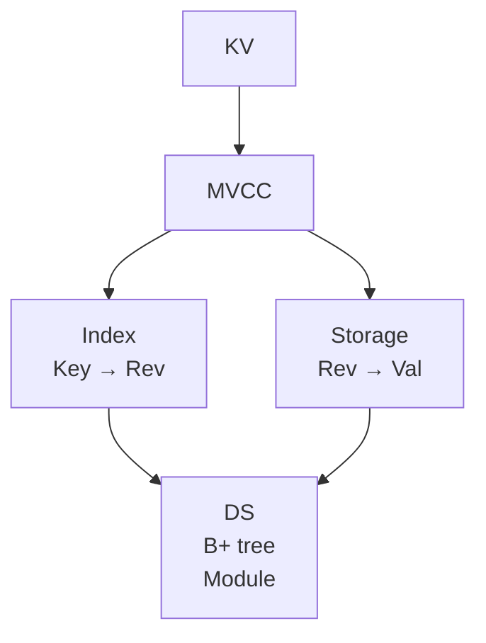
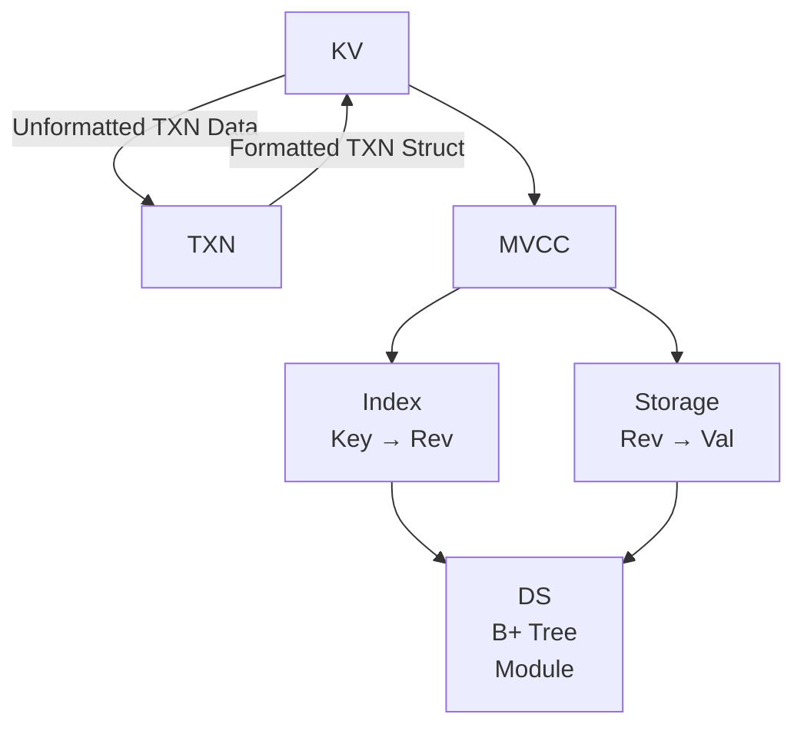
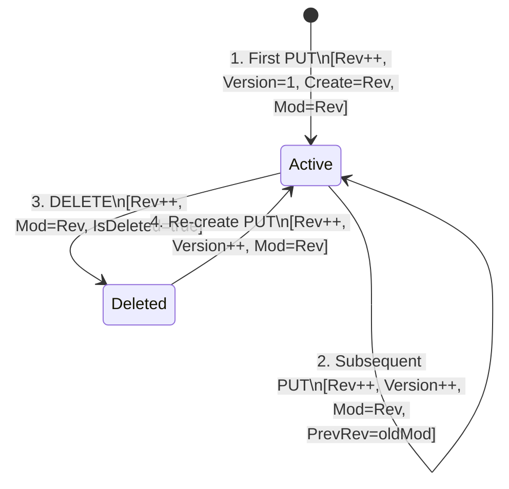
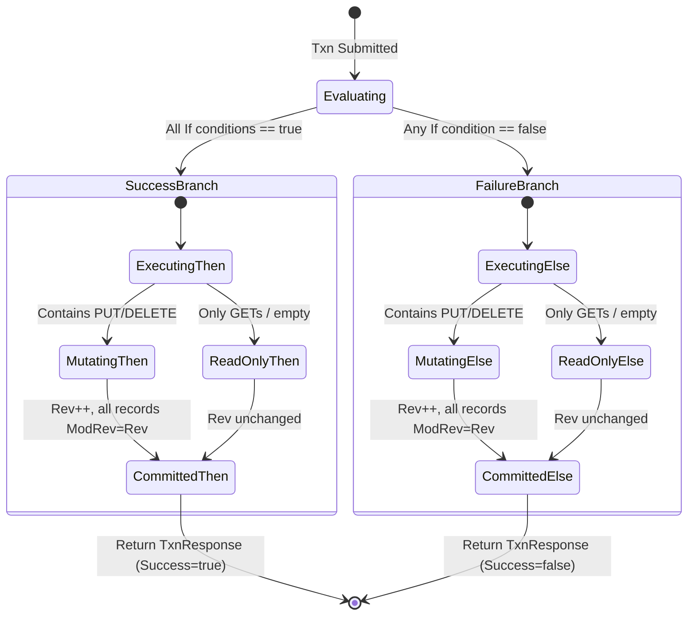

# Problem Statement: 
1. Build a storage mechanism that can get and put a value based on its key. It should also provide any version of that key value from history. This also helps in concurrency control.
2. Transactions : for atomic multi-key addition 


# Requirement Analysis:

Functional Requirements:
1. when you add a value it should accept key and value : PUT a key
2. When you ask for value asking this version it should return it : GET a key
3. delete the key
4. It should also give all the versions of the data
5. Should support transactions

Non-Functional Requirements:
1. Concurrent operations must behave correctly.
2. Reads should have predictable latency.
3. Memory consumption should remain bounded.
4. Transactions should be atomic

Constraints:
1. No contrainst for now because 

Assumptions:
1. the system should be designed to running on a single high end devices.

Out of scope:
1. Crash Recovery
2. Performance enhancement


# Fundamental Reasoning and Research:

1. Generations
2. Leases
3. Indexing
4. Compaction
5. Transactions
6. Revisions
7. Determinism

###  Implementation Solutions:
1. Simplest solution:
	Directly add the data and give versions for each.
	And have a index that maps key to the revision for quick access
	
	So basically you have a storage engine:
	that is  storing key and values 
	key would be revision and revision represents global revisions basically a incremental value that would tell you the number of operations that has happens. It is like a number column
	
	Value would be:
	- the actual key  which is something like "/pod/1"
	- the actual value which is the state of pod json with keys like name, status etc
	- create revision 
	- modified revision
	- Version indicating how many time the thing got modified
	
	there would be another index for mapping key to revision for quick access
	- key -> "/pod/somethi"
	- value -> revision key 
There are other available approaches other than MVCC
This is MVCC an i am implementing it because i am learning about MVCC

2. Implementation for transaction:
Input will be 
```
txn:
   if:
      conditions
   then:
      operations
   else:
      operations
```
first check the conditions if all are true 
then implement operations
else implement operations


# System Decomposition


with transaction

# Data modeling objects and invariants

  ### Object 1: Revision (The Logical Clock)

  Represents a point-in-time state of the entire cluster.
  • Invariant 1.1 (Strict Monotonicity): For any new mutating event e₂ after e₁, Rev(e₂) > Rev(e₁). Revisions strictly increase and never repeat.
  • Invariant 1.2 (Total Ordering): For any two distinct revisions Rₐ and R_b, either Rₐ < R_b or Rₐ > R_b. Ambiguity is mathematically impossible.
  • Invariant 1.3 (Immutability of History): Once a state is committed at revision R, the record at R is frozen. Only a higher revision can represent changes.
  ──────
  ### Object 2: Key (KeyIndex)

  Represents the lifecycle, routing, and identity of a resource name (e.g., "/pods/nginx").
  • Invariant 2.1 (Revision Ordering): ModRev ≥ CreateRev > 0 for any active key.
  • Invariant 2.2 (Version Semantics):
      • When Active, Version ≥ 1.
      • On every update within the same lifespan: Version_{new} = Version_{old} + 1.
  • Invariant 2.3 (Generation Boundary):
      • Deleting a key ends its current generation.
      • Re-creating the key starts a brand new generation where Version resets to 1, but CreateRev_{new} > DeleteRev_{old}.
  • Invariant 2.4 (Storage Coherence): KeyIndex.ModRev must always point to a valid record existing in the Revision Storage.
  ──────
  ### Object 3: Value (Record)

  Represents the concrete historical snapshot payload stored at a specific revision.

  • Invariant 3.1 (Append-Only Permanence): A Record stored at revision R is never modified or updated in-place.
  • Invariant 3.2 (Self-Contained Metadata): Every record embeds Key, CreateRev, ModRev, Version, and Value.
  • Invariant 3.3 (Tombstone Guarantee): If IsDeleted == true, then Value == nil. It serves as an immutable marker of deletion.
  ──────
  ### Object 4: Transaction (Txn)

  Represents an atomic, conditional batch of operations evaluated against a point-in-time MVCC state.

  • Invariant 4.1 (All-or-Nothing Atomicity): For any transaction T, either all operations in the selected branch are committed, or none are. A transaction can never leave the store in a partially applied state.
  • Invariant 4.2 (Branch Mutual Exclusivity): Execution of T_then and T_else is strictly mutually exclusive. If all conditions hold, T_then executes; if any condition fails, T_else executes. Exactly one branch executes.
  • Invariant 4.3 (Single Monotonic Revision Tick): If the executed branch performs k mutating operations (k ≥ 1 PUT or DELETE), the global revision advances by exactly one (R_new = R_prev + 1), and all k records share the exact same ModifiedRev = R_new. If the executed branch performs zero mutating operations, the global revision does not advance.
  • Invariant 4.4 (Serial Snapshot Isolation): Condition evaluation and branch execution occur within a single atomic critical section under lock. No concurrent read or write can observe or interleave between condition evaluation and record writes.
  • Invariant 4.5 (Consensus Determinism): Given the identical transaction payload T applied to identical state at revision R, the condition evaluation, branch choice, generated records, and resulting R_new must be 100% deterministic across all Raft nodes.

 State Transitions 

  A key is either Active or Deleted (or doesn't exist yet):



  A transaction evaluates atomically against a snapshot:



# Interface and Contract

The MVCC layer exposes simple, high-level methods so callers (Raft FSM, API server) don't need to know how the trees or revisions work internally.

### Methods
1. **`Put(key string, val []byte) (rev int64, prev *Record)`**
   * Input: Key and raw byte payload.
   * Output: New global revision number and previous record (if any).
2. **`Get(key string) (*Record, bool)`**
   * Input: Key.
   * Output: The latest active record and whether it exists.
3. **`GetAtRevision(key string, targetRev int64) (*Record, bool)`**
   * Input: Key and historical revision number.
   * Output: State of that key at that exact past revision.
4. **`GetPrefix(prefix string) []*Record`**
   * Input: Key prefix (e.g., `"/pods/"`).
   * Output: All active records starting with that prefix.
5. **`Delete(key string) (rev int64, prev *Record, bool)`**
   * Input: Key.
   * Output: New tombstone revision and previous record.
6. **`Txn(txn *Txn) *TxnResponse`**
   * Input: `Txn` struct with `If` conditions, `Then` operations, and `Else` operations.
   * Output: `TxnResponse` with `Success bool`, `Rev int64`, and execution results.

---

# Implementation Plan (In Simple Words)

### Step 1: Define the `Record` Data Struct (`kv/mvcc.go`)
Since both index and storage live in memory, we do not need a separate `KeyIndex` struct. All metadata lives directly on the immutable record:
* `Record`: holds `Key`, `Value`, `CreateRev`, `ModRev`, `Version`, `PrevRev`, and `IsDeleted`.

### Step 2: Build the `MVCCStore` Engine (`kv/mvcc.go`)
Create the `MVCCStore` struct holding:
* `currentRev int64` (global logical clock).
* `index *BTree` (B+ tree directly mapping `key string -> latestRev int64`).
* `storage *BTree` (B+ tree mapping zero-padded revision string `fmt.Sprintf("%020d", rev) -> *Record`).
* `mu sync.RWMutex` (for thread safety).

Implement the 5 methods:
1. **`Put(key, val)`**:
   * Increments `currentRev` by 1.
   * Checks `index.Get(key)`:
     * If existing: loads previous record from `storage` to inherit `CreateRev`, sets `Version = prev.Version + 1`, and `PrevRev = oldRev`.
     * If new: sets `CreateRev = currentRev`, `Version = 1`, and `PrevRev = 0`. 
   * Saves new `Record` into `storage` under `currentRev`.
   * Updates `index` to point `key -> currentRev`.
2. **`Get(key)`**:
   * Looks up `rev` in `index` ($O(\log N)$).
   * Fetches and returns `storage.Get(rev)`.
3. **`GetAtRevision(key, targetRev)`**:
   * Looks up `rev` in `index` and fetches the latest record.
   * Walks backwards following `record.PrevRev` until finding a version where `ModRev <= targetRev`.
   * Returns record if valid and not a tombstone.
4. **`GetPrefix(prefix)`**:
   * Uses `index.AscendPrefix(prefix)` to find all matching active keys and their latest revisions.
   * Pulls each record from `storage` and returns the slice.
5. **`Delete(key)`**:
   * Increments `currentRev` by 1.
   * Reads previous revision from `index`.
   * Writes a tombstone `Record` (`IsDeleted: true`, `PrevRev: oldRev`, `ModRev: currentRev`) into `storage`.
   * Deletes the key from `index`.

### Step 3: Connect MVCC to Raft FSM (`kv/kv.go`)
Wire `MVCCStore` into the main `KVStore`:
* Replace the placeholder map in `KVStore` with `MVCCStore`.
* When Raft calls `Apply(cmd)`:
  * If `cmd.Op == "PUT"` -> calls `mvcc.Put(cmd.Key, []byte(cmd.Value))`.
  * If `cmd.Op == "DELETE"` -> calls `mvcc.Delete(cmd.Key)`.
  * Return the revision receipt back to Raft.

### Step 4: Write Unit Tests (`kv/mvcc_test.go`)
Verify every behavior in isolation:
* Test 1: Basic Put, Get, Update, and Delete.
* Test 2: Prefix Scan (insert `/pods/a`, `/pods/b`, `/nodes/1`, verify `GetPrefix("/pods/")` returns only the 2 pods).
* Test 3: Time-travel historical reads (update a key 3 times, verify you can read version 1 at revision 1).
* Test 4: Concurrency test with Go's race detector (`go test -race ./kv/...`).

### Step 5: Implement Transactions (`kv/transaction.go` & `kv/mvcc.go`)
* `kv/transaction.go`:
  * Define `Compare` (Key, Target: `MOD_REV`, `VERSION`, `VALUE`, Operator: `==`, `!=`, `<`, `>`, Value).
  * Define `Op` (Type: `PUT`, `DELETE`, `GET`, Key, Value).
  * Define `Txn` (If `[]Compare`, Then `[]Op`, Else `[]Op`).
  * Define `TxnResponse` (Success `bool`, Rev `int64`, Responses `[]OpResult`).
* `kv/mvcc.go`:
  * Implement `Txn(txn *Txn) *TxnResponse` under `e.mu.Lock()`.
  * Evaluate all `If` conditions against the current MVCC state (Index + Storage).
  * Select branch (`Then` if all conditions match, else `Else`).
  * If the branch contains mutations, increment `currentRev` by 1 and apply all mutations sharing that same revision.
  * Return `TxnResponse`.
* `kv/mvcc_test.go`:
  * Test successful Compare-and-Swap transactions.
  * Test failed condition branch execution.
  * Test atomic single-revision increment across multiple batched writes.
